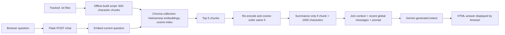

# Admissions Counseling Chatbot — Backend and RAG portfolio audit

**Scope:** Source snapshot on branch `improve/backend-portfolio`, reviewed 17 October 2026. This is a static code and Git-history review; no live Gemini request, deployment, retrieval benchmark, or user study was run. The stated 8.5/10 grade and three-person team size come from the project owner, not from repository evidence.

## 1. What the repository actually contains

This is a Python/Flask web application, not a Java service. Flask serves the chat page and a JSON `POST /chat` endpoint, plus session-protected admin pages for uploading and deleting `.txt` documents ([`app.py`](../app.py#L52-L78), [`app.py`](../app.py#L83-L186)). Browser JavaScript sends `{ "message": ... }` to `/chat` and displays the returned `{ "response": ... }` ([`static/js/script.js`](../static/js/script.js#L43-L83)).

The knowledge source is the tracked text corpus in `data/topics/`. A separate script builds a persistent Chroma collection called `ptit_chatbot_rag` using the Vietnamese `bkai-foundation-models/vietnamese-bi-encoder` and cosine space ([`src/build_database.py`](../src/build_database.py#L9-L38)). The online path uses that same model to encode questions, retrieves from Chroma, then calls Gemini's `generateContent` REST endpoint for the final answer ([`src/chatbot.py`](../src/chatbot.py#L15-L49), [`src/chatbot.py`](../src/chatbot.py#L191-L270)). The repository does not contain a deployment configuration, benchmark suite, or implemented automated tests; [`tests/test_chatbot.py`](../tests/test_chatbot.py) is empty.

The admin upload path differs from the offline path: it saves the file, divides it into **800-character** chunks, and calls `collection.add`; the build script uses **600-character** chunks ([`app.py`](../app.py#L127-L146), [`src/chatbot.py`](../src/chatbot.py#L105-L150), [`src/build_database.py`](../src/build_database.py#L50-L69)). These are character windows without sentence boundaries or overlap. Document metadata contains `file` and `segment`; the answer prompt does not include source IDs or citations.

## 2. Complete online RAG pipeline

1. **Startup:** `.env` and `.env.local` are loaded; missing `GEMINI_API_KEY` raises before the app starts. The embedding model and existing Chroma collection are loaded at module import time, so a fresh clone must build the collection first ([`src/chatbot.py`](../src/chatbot.py#L10-L24), [`src/chatbot.py`](../src/chatbot.py#L51-L60), [`README.md`](../README.md#L23-L35)).
2. **Request:** `POST /chat` reads `request.json.get('message')`; a falsey value receives HTTP 400, while other values are passed directly to the RAG function ([`app.py`](../app.py#L61-L78)).
3. **Retrieval:** The current question is encoded once with the Vietnamese SentenceTransformer. Chroma receives `query_embeddings=[...]` and returns up to five chunks. Empty results yield a fixed apology ([`src/chatbot.py`](../src/chatbot.py#L198-L208)).
4. **Second ordering pass:** The question and the five retrieved document strings are encoded again with the *same* model; cosine similarity orders those same five strings. `top_n=5`, so none of the five is filtered out ([`src/chatbot.py`](../src/chatbot.py#L77-L85), [`src/chatbot.py`](../src/chatbot.py#L210-L215)).
5. **Context preparation:** Chunks longer than 1,000 characters would be summarized with Gemini, with a silent fallback to original text on failure. Normal chunks produced by either included ingestion path are at most 600 or 800 characters, so this branch is normally inactive. The five chunks are joined with `---` ([`src/chatbot.py`](../src/chatbot.py#L65-L75), [`src/chatbot.py`](../src/chatbot.py#L87-L90), [`src/chatbot.py`](../src/chatbot.py#L210-L218)).
6. **Generation and presentation:** The prompt includes the fused context, current question and last three **messages** in a process-global list. It instructs Gemini to answer only from context, distinguish Hanoi and HCMC, and return HTML. The response is stripped of optional code fences, appended to global history, returned in JSON, and inserted into the page with `innerHTML` ([`src/chatbot.py`](../src/chatbot.py#L220-L270), [`static/js/script.js`](../static/js/script.js#L91-L99)).

The stored conversation does **not** rewrite or augment the retrieval query. A short follow-up such as “What about HCMC?” is searched as written, even though history is later supplied to Gemini.

## 3. Retrieval work already present, with limits

| Implemented in source | Evidence | What can be claimed |
| --- | --- | --- |
| Domain documents are embedded with a Vietnamese bi-encoder in a persistent cosine Chroma index. | [`src/build_database.py`](../src/build_database.py#L9-L38) | Vietnamese semantic retrieval is implemented. No measured accuracy claim yet. |
| The online query is explicitly encoded and passed as `query_embeddings`, avoiding reliance on Chroma's default query embedder. | [`src/chatbot.py`](../src/chatbot.py#L198-L203); Git blame attributes this change to `74cbec77`. | A concrete embedding-consistency fix. |
| Candidate count was increased to five and a same-model cosine ordering pass was added. | [`src/chatbot.py`](../src/chatbot.py#L77-L85), [`src/chatbot.py`](../src/chatbot.py#L200-L215); Git blame attributes this path to `468a514b`. | A retrieval-ordering experiment, **not** evidence of higher recall or a separate learned reranker. Recall@5 cannot change because the candidate set remains the same. |
| Uploaded chunks have stable IDs and file/segment metadata; IDs already present are skipped. | [`src/chatbot.py`](../src/chatbot.py#L124-L150) | Basic duplicate-ID avoidance, **not** reliable update/upsert behavior. |
| A context-only instruction and fallback answer are included in the generation prompt. | [`src/chatbot.py`](../src/chatbot.py#L225-L249) | Grounding intent in the prompt, **not** a verified hallucination rate or citation system. |

The two files `cach_ting_diem.txt` and `cach_tinh_diem.txt` are near duplicates (verified by a local text comparison). This can put substantially repeated content in the top five. The corpus has no source URLs, effective dates, or document version fields in retrieval metadata.

## 4. Backend and security review

| Area | Current behavior and consequence | Evidence |
| --- | --- | --- |
| API contract | Missing/empty `message` returns 400, but content type, JSON shape, string type and length are not validated. `request.json.get` can fail before that check for malformed or non-object JSON. Retrieval, embedding and collection failures have no request-level exception handling. Gemini failures are converted to natural-language strings with HTTP 200, so the browser cannot distinguish an answer from an upstream failure. | [`app.py`](../app.py#L61-L78), [`src/chatbot.py`](../src/chatbot.py#L251-L290) |
| Conversation isolation | One module-global list is shared by all users/process requests; history can mix users, grow without bound, and disappear on restart. `[-3:]` is three messages rather than three user/assistant exchanges. Questions and retrieved context are printed to server logs. | [`src/chatbot.py`](../src/chatbot.py#L62-L63), [`src/chatbot.py`](../src/chatbot.py#L196-L223), [`src/chatbot.py`](../src/chatbot.py#L265-L267) |
| Upload/update | Authentication and a 16 MB request cap exist; `.txt` extension and `secure_filename` are checked. The file is saved **before** indexing. Reuploading the same filename skips existing chunk IDs, so edited content may leave stale vectors; if the new file is shorter, old trailing chunks remain. The admin page's claim that existing files are “updated” is therefore inaccurate. The offline and upload chunk sizes also differ. | [`app.py`](../app.py#L25-L37), [`app.py`](../app.py#L110-L146), [`templates/admin.html`](../templates/admin.html#L68-L74), [`src/chatbot.py`](../src/chatbot.py#L116-L150) |
| Delete consistency | The helper can return `success=True` even when Chroma deletion raises; the route then removes the source file. Files and vectors can diverge, and errors may be shown as success. The delete route uses the path filename without a second canonicalization or allowlist check. | [`src/chatbot.py`](../src/chatbot.py#L156-L189), [`app.py`](../app.py#L158-L186) |
| Public deployment risk | Admin email/password and Flask session signing key are hard-coded; development server binds to `0.0.0.0` with debug enabled. Upload/delete forms have no CSRF token; the template's comment wrongly says sessions make it unnecessary. Chat text from both users and Gemini is assigned to `innerHTML`, which permits script injection. A prior `.env` containing a key-like value exists in Git history even though it is ignored now; exposed historical keys should be revoked. | [`app.py`](../app.py#L22-L33), [`app.py`](../app.py#L189-L193), [`templates/admin.html`](../templates/admin.html#L141-L151), [`static/js/script.js`](../static/js/script.js#L91-L99); `git log main -- .env` |
| Reproducibility | Dependencies and embedding-model revision are unpinned. Chroma's embedding-function persistence behavior changed across releases, so the embedding function used by later `get_collection`/`add(documents=...)` should be pinned or made explicit and verified. No executable test asserts the HTTP or retrieval behavior. | [`requirements.txt`](../requirements.txt), [`src/chatbot.py`](../src/chatbot.py#L51-L58), [`tests/test_chatbot.py`](../tests/test_chatbot.py); [Chroma collection documentation](https://cookbook.chromadb.dev/core/collections/) |

Flask's [security guidance](https://flask.palletsprojects.com/en/stable/web-security/) confirms that a session cookie does not replace CSRF protection and documents request limits and cookie settings. These findings concern a possible public deployment; the repository currently documents a local development run, not a production-ready service.

## 5. Reproducible retrieval evaluation proposal

No retrieval-quality metric is present today. Build a small **versioned evaluation set** before changing retrieval code:

1. Freeze a corpus snapshot, chunking rule, embedding-model revision, Chroma version, and query set. Record document IDs, original source filename, and corpus hash so another person can rebuild the same index. Keep private API keys out of the dataset.
2. Have a reviewer label admission questions against one or more relevant source passages or source files. Include direct facts, paraphrases, questions that distinguish Hanoi/HCMC, follow-up questions, near-duplicate documents, and unanswerable/out-of-scope questions. Split any tuning examples from a held-out set; do not invent an accuracy result before running it.
3. Run **retrieval without Gemini** using the same frozen questions. Compare Chroma's original top five with the current same-model ordering. Report Recall@1/3/5, MRR@5 and nDCG@5 where passage-level relevance grades exist, plus per-category errors. Since both runs use the same five candidates, Recall@5 must be equal; ordering metrics can differ. For follow-ups, evaluate the raw query separately from a contextualized query variant if later implemented.
4. Evaluate answer quality separately on the same questions: whether each answer is supported by retrieved passages, whether required campus distinctions are present, and whether abstention occurs for missing evidence. Use human review or a documented rubric; keep Gemini model/settings fixed and report cost/latency only after measuring them. Save aggregate results and a few anonymized failure examples in the repository.

Also test document replacement and deletion as **data-consistency** cases: compare file content to indexed IDs and retrieved text before/after each operation. These are correctness checks, not retrieval scores.

## 6. Three high-impact improvements, in order

1. **Make the backend safe and predictable before a public demo.** Replace hard-coded admin credentials and signing key, turn off debug for deployment, add CSRF protection, render user text as text and sanitize or restrict model HTML, validate `POST /chat`, isolate conversation state, and return structured error status codes. Treat historical exposed keys as compromised and rotate them. This addresses the largest security and API-quality risks.
2. **Unify ingestion and prove retrieval quality.** Use one chunking and embedding configuration for offline builds and uploads; replace all vectors for an updated file rather than skipping IDs, and keep source-file/vector deletion consistent. Preserve source/date metadata and deduplicate overlapping documents. Establish the labeled retrieval evaluation above, then keep or remove same-model reordering based on measured ranking benefit.
3. **Turn the repository into a verifiable portfolio artifact.** Add focused HTTP and ingest consistency tests, pin dependency/model versions, and document a reproducible demo with an architecture diagram and measured evaluation results. Present it honestly as a Python backend/RAG project that demonstrates transferable API, data, integration and testing skills for a Java Backend Intern role.

## 7. CV claims supported by evidence

Git blame associates `Hoang Van Dung` / `HoangDung05` with the Flask `/chat` route (`92e85195`), admin upload/delete routes (`4aa09215`, `468a514b`), Gemini REST integration and explicit query embeddings (`74cbec77`), and same-model cosine ordering (`468a514b`). The vector builder is shared history: its collection/model setup has lines attributed to Hoang Van Dung, while much of the file ingestion loop is attributed to a teammate (`53ee82c7`). Git authorship is evidence of edits, not sole ownership of the group project.

Suggested CV wording (without unmeasured claims):

> **Admissions Counseling Chatbot — Team Lead / Backend Developer (3-person project, Python/Flask)**
>
> Built the Flask chat API and admin document upload/delete flows; integrated Gemini REST generation with Vietnamese-embedding retrieval in ChromaDB. Added explicit query embeddings and a cosine-based candidate ordering step. Coordinated the team and reviewed chatbot responses. *(Team-leadership and review duties are owner-reported; Git can verify the code contributions.)*

For a Java Backend Intern application, emphasize API contracts, data consistency, external-service integration and evaluation discipline. Do not label this a Java or Spring Boot implementation, or claim accuracy, latency, user scale, production deployment, or a dedicated reranker without evidence. The 8.5/10 grade can be stated as course context if independently documented.

## 8. README, visuals and demo presentation plan

- **README:** Open with a two-sentence problem/solution summary, role and team size, tech stack, and a feature list matching code. Then show the architecture diagram above, exact local setup (including vector-index build and environment variables), API request/response example, current limitations, evaluation method/results once run, and contribution split. Remove the stray `fix` line at the end of the current README ([`README.md`](../README.md#L56-L57)). State clearly that admin access and debug settings are for local development only.
- **Screenshots:** Capture the chat UI, a representative grounded answer that distinguishes campuses, and the admin document page. Blur secrets, private data and local paths. Give each image a short caption describing the demonstrated feature; store them in a predictable `docs/screenshots/` directory only after capturing real UI states.
- **Architecture diagram:** Publish a clean version of the Mermaid flow above, and show the **offline rebuild** and **admin upload** as distinct ingestion paths because they currently chunk differently. Avoid depicting citations, a cross-encoder reranker, authentication service, or production infrastructure that the code does not provide.
- **Demo:** A short screen recording can show fresh setup, index build, one direct question, one follow-up, an out-of-scope question, and an admin upload/replacement check. Show actual outputs, note any failed behavior rather than editing it out, and never display API keys. Link a successful hosted demo only after hardening and validating a real deployment.

**Review boundary:** Findings above are from source inspection, Git blame, and local text comparison. They are not measured performance, exploit tests, or proof of the live Gemini service's availability.
